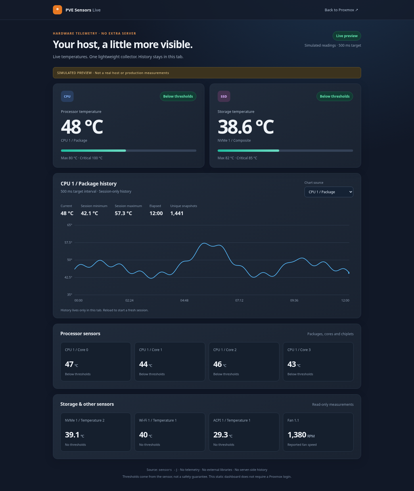
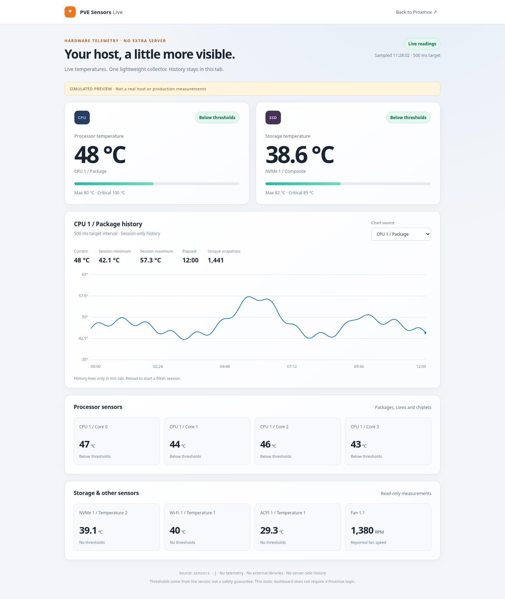
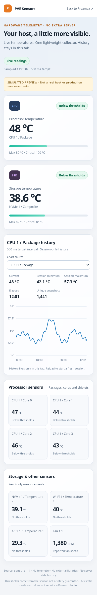
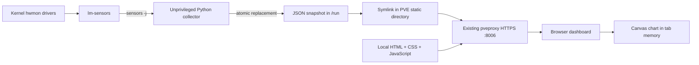

# PVE Sensors Live

**Live hardware temperatures in your existing Proxmox VE web server. No extra dashboard stack.**

PVE Sensors Live adds a small, standalone hardware dashboard to a Proxmox VE node. A read-only Python collector polls `lm-sensors`, writes one JSON snapshot under `/run`, and lets the existing `pveproxy` HTTPS service deliver it to a plain HTML/CSS/JavaScript page. The CPU chart starts when you open the page and lives only in that browser tab.

**One additional APT package when needed: `lm-sensors`.** Python's standard library, systemd and Debian base utilities come from the host. There is no pip, npm, CDN, database, container, exporter stack, charting library, extra web server or new listening port.

> **Read this before installing:** the page and its JSON are static resources. They are accessible **without a Proxmox login** to anyone who can reach their URL. Use a trusted management network or an appropriate access-control gateway. This is not an authenticated Proxmox plugin. The installer requires `--accept-public-data` to acknowledge that boundary.



<details>
<summary>Light theme and mobile screenshots</summary>





</details>

## What it does

- Displays available CPU, storage, system, GPU temperature and fan-speed readings from `sensors -j`.
- Targets a **500 ms** polling interval by default, configurable between 100 ms and 60 seconds.
- Plots a selectable CPU sensor with session minimum, maximum, elapsed time and unique snapshot count.
- Recognizes familiar Intel CPU, AMD CPU, NVMe, drive, Wi-Fi and ACPI drivers. Other temperature channels receive generic labels.
- Uses sensor-reported temperature thresholds when present. Missing thresholds are not treated as proof of safety, and zero RPM is not automatically treated as a failed fan.
- Flags stale snapshots, skips duplicate samples, handles reconnects and pauses browser polling while the tab is hidden.
- Keeps bounded chart memory by downsampling long sessions while retaining the overall time span and extrema.

It does **not** control fans, configure sensors, run automatic hardware probing, provide alert delivery, store historical measurements on the server, or add an authenticated tab to the Proxmox navigation menu.

## Requirements and compatibility

The intended target is a **Proxmox VE 9.x host** with systemd and Python 3.9 or newer. Run the installer on the physical node, not in a guest VM or LXC container. The static asset directory must be `/usr/share/pve-manager/js`, and `sensors -j` must expose at least one valid temperature or fan measurement to an unprivileged account.

| Component | Where it comes from |
| --- | --- |
| `lm-sensors` and its required libraries | Installed from the host's existing APT repositories if `/usr/bin/sensors` is missing |
| Python 3.9+ | Existing host runtime; standard library only |
| systemd, Bash, `runuser`, `timeout`, `flock`, core utilities | Existing Proxmox/Debian base system |
| HTTPS on port 8006 | Existing `pveproxy`; no restart or configuration change |
| HTML, CSS, JavaScript, Python collector, unit file | Embedded in `install.sh`; also available as readable source files |

The installer checks the base system instead of repairing or upgrading a damaged Proxmox installation. It does not modify repositories or disable certificate validation for package downloads. If APT has unrelated repository errors, resolve them separately.

This project uses an existing static-file route, **not a supported Proxmox extension API**. Future Proxmox releases may change that behavior. The standalone routing approach has been exercised on Proxmox VE 9.x, but this generalized release has not been integration-tested across supported hardware or every Proxmox version. See [validation notes](docs/VALIDATION.md).

## Install

Copy the project to the Proxmox host, change into its directory, inspect the installer and run:

```bash
sha256sum -c SHA256SUMS
less install.sh
bash install.sh --accept-public-data
```

`install.sh` is self-contained. Copying **only that file** is sufficient for installation; the rest of the repository is for review, documentation and development. When using the single file, compare its checksum with the release manifest before running it. A checksum detects file changes; it is not an independent signature of the publisher.

For a reviewed unattended installation:

```bash
bash install.sh --accept-public-data --yes --interval 0.5
```

The installer will:

1. Verify that it is running as root on a Proxmox host, and validate its embedded Python source.
2. Install `lm-sensors` only when needed, using your existing APT repositories, `--no-install-recommends` and `--no-remove`. It displays a simulated package plan before asking for confirmation, unless `--yes` was supplied.
3. Check sensor access with the existing `nobody` account. The actual collector uses a separate systemd dynamic identity, not this shared account.
4. Back up this project's existing files and service state under `/var/backups/pve-sensors/`.
5. Install the collector, its systemd unit, three static web files and a JSON symlink. It starts only `pve-sensors.service`.
6. Wait for a fresh snapshot, verify that `www-data` can read it, and test the files over HTTPS loopback without a login cookie or API token.

Only the project's own service is stopped or restarted on upgrade. `pveproxy`, `pvedaemon`, VMs and containers are not restarted. No stock Proxmox JavaScript or Perl file is patched. Existing unrelated collectors are not stopped automatically; stop a previous collector explicitly when replacing a different solution.

### Open the dashboard

In the browser address you normally use for this node, keep the same scheme, hostname and port 8006, and replace the path with:

```text
/pve2/js/pve-sensors.html
```

No hostname or IP address is embedded in the project. Web assets and JSON use relative URLs. A bookmark is sufficient; adding a Proxmox sidebar item is deliberately out of scope.

Each node serves its **own** local measurements. Connecting to another node in a cluster does not aggregate or proxy this dashboard's data.

### Restricted listeners

By default, installation verifies `https://127.0.0.1:8006`. For this **local verification only**, the probe accepts the node's self-signed certificate. It does not change the node's TLS configuration or the browser's certificate validation.

If `pveproxy` is intentionally bound to a management address rather than loopback, inspect that setup and use:

```bash
bash install.sh --accept-public-data --skip-http-check
```

This skips the HTTPS probe only. Filesystem permissions, collector startup and fresh JSON checks still run. Verify the page from your management browser afterward.

## Architecture



The collector is a single long-lived process. Each interval launches one bounded `sensors -j` read, extracts allowlisted fields, and atomically replaces the snapshot. It never starts a web server. Browser reads are handled by the web server already running on the host.

| Path | Purpose |
| --- | --- |
| `/usr/local/libexec/pve-sensors-agent.py` | Collector |
| `/etc/systemd/system/pve-sensors.service` | Hardened service definition |
| `/etc/default/pve-sensors` | Polling interval |
| `/run/pve-sensors/metrics.json` | Current snapshot; recreated after reboot |
| `/usr/share/pve-manager/js/pve-sensors.json` | Symlink to the runtime snapshot |
| `/usr/share/pve-manager/js/pve-sensors.html` | Dashboard page |
| `/usr/share/pve-manager/js/pve-sensors.css` | Local styling |
| `/usr/share/pve-manager/js/pve-sensors.js` | Local rendering and chart code |
| `/usr/local/share/pve-sensors/installed-version` | Ownership/version marker for upgrades and removal |
| `/var/backups/pve-sensors/` | Root-readable installation backups |

`/run` is normally tmpfs. There is no project-managed disk history or per-sample write to the web asset directory. This is **not** a claim of zero disk I/O: tmpfs may be swapped depending on host settings, service failures may enter the journal, and `pveproxy` can write an access-log entry for each browser request. The project does not disable or alter Proxmox logging.

## Sampling and chart behavior

The default 0.5-second interval is a target, not a real-time guarantee. Sensor drivers may refresh less frequently, collection may take longer, and browsers can throttle background work. Two different snapshots can legitimately contain identical temperatures.

Only one read is in flight in the collector. If a read exceeds its interval, the agent skips missed deadlines instead of generating a burst. A read is bounded by a two-second subprocess timeout. Successful operation is not logged once per sample; repeated failures are rate-limited in the collector's own messages.

Browser requests do not overlap. The UI follows the interval advertised in the snapshot and backs off after a request failure. It detects unchanged snapshots with a per-process random session identifier and a sequence number, so sub-second samples are not confused by second-resolution file timestamps. The session identifier is not a host identifier or credential.

The chart records **snapshots observed by that tab**, not every server measurement. It cannot reconstruct observations missed during a network interruption or while the tab was hidden. Gaps are left visible. Reloading the page or selecting another CPU sensor starts a new history. When more than 16,000 points accumulate, older detail is compacted while retaining the whole time span and temperature extrema. There is no localStorage, IndexedDB, cookie, browser-to-server history upload or server database.

### Change the interval

Re-run the installer with an explicit value:

```bash
bash install.sh --accept-public-data --interval 1
```

Or edit `/etc/default/pve-sensors` and restart only the collector:

```bash
editor /etc/default/pve-sensors
systemctl restart pve-sensors.service
```

The setting is `PVE_SENSORS_INTERVAL=0.5`. Without an explicit `--interval`, an upgrade preserves a valid existing setting.

100 ms is permitted but **experimental**, not the recommended default. It can create ten sensor reads and approximately ten HTTP requests per second per visible tab. Faster polling does not increase a hardware sensor's native refresh rate. Measure the actual effect on your host rather than assuming negligible overhead.

### Check resource use

```bash
systemctl show pve-sensors.service -p MemoryCurrent -p CPUUsageNSec -p TasksCurrent
journalctl -u pve-sensors.service -n 30 --no-pager
```

`CPUUsageNSec` is cumulative CPU time, not an instantaneous percentage. To estimate the collector's average use of one logical CPU over ten seconds:

```bash
python3 - <<'PY'
import subprocess
import time

def cpu_ns():
    return int(subprocess.check_output([
        'systemctl', 'show', 'pve-sensors.service',
        '--property=CPUUsageNSec', '--value'
    ], text=True).strip())

before = cpu_ns()
started = time.monotonic()
time.sleep(10)
after = cpu_ns()
elapsed = time.monotonic() - started
if after < before:
    raise SystemExit('The service restarted during the measurement; repeat it.')
print(f'Average collector CPU: {(after - before) / 1e9 / elapsed * 100:.2f}% of one logical CPU')
PY
```

That measurement does not include the additional work performed by `pveproxy` or the browser. No universal CPU or memory benchmark is promised.

## Security and privacy

The service uses `DynamicUser=yes`, an empty capability set, a read-only system view, private devices and temporary files, and its own network namespace. It has no TCP/UDP socket access. It can write its runtime directory, but cannot modify the installed web files. Sensor reads use a fixed subprocess argument list, not a shell command built from input.

The snapshot contains temperature and fan values, sanitized category/role labels, thresholds, timestamps, collection timing and an ephemeral sequence identity. Raw sensor labels, bus addresses, serial numbers, usernames, hostname, IP addresses, CPU model names, DMI data and Proxmox credentials are not exported. Unknown inputs receive generated names. This reduces identifying information but does not make public telemetry anonymous: sensor counts and changing temperatures can still reveal hardware characteristics and workload activity.

The page uses local assets, a restrictive Content Security Policy, `textContent` for sensor names, no credentials in its JSON requests, and no analytics. It does not fetch scripts, fonts or charts from an external service. It is still JavaScript served from the Proxmox management origin, so review it as trusted code before installation.

No `sensors-detect`, `sensors -s`, `i2cdetect`, module loading, GPU capability changes, firewall changes or automatic updates are performed. No API token or root password is needed after installation.

More detail: [SECURITY.md](SECURITY.md). Scope of the publication audit: [privacy review](docs/PRIVACY_REVIEW.md).

## Upgrade, remove and recover

To upgrade, review a new copy of `install.sh` and run it with `--accept-public-data`. It replaces only its reserved files, preserves the polling interval, and creates a backup first. There is no background updater or post-APT patch hook.

To remove:

```bash
bash install.sh --uninstall
```

Uninstallation stops and disables `pve-sensors.service`, removes its managed files and reloads systemd's unit definitions. It leaves `lm-sensors`, required packages and backup directories installed. It does not touch Proxmox files outside the project's reserved filenames. Empty administrative directories may remain.

If installation fails after project files have changed, the installer attempts to restore the previous project files and active/enabled service state. **Rollback is best-effort, not transactional.** APT changes are not undone. Read the reported backup path and inspect the service state after an error.

To stop polling without removing anything:

```bash
systemctl disable --now pve-sensors.service
```

## Troubleshooting

**No sensor data.** Run `sensors -j` on the host. Hardware support depends on loaded kernel drivers and firmware. The installer intentionally does not probe buses or load modules automatically. Decide whether additional hardware-specific configuration is appropriate before changing the host.

**CPU chart is unavailable, but other cards work.** A known CPU driver may not be exposed. Other valid channels are still shown with generic labels. Extend the classification rules and synthetic tests for additional hardware; do not guess that an arbitrary motherboard channel is the CPU.

**Stale or unreachable snapshot.** Check `systemctl status pve-sensors.service --no-pager`, `journalctl -u pve-sensors.service -n 30 --no-pager`, and `readlink /usr/share/pve-manager/js/pve-sensors.json`. The agent retains the last successful snapshot after a collection failure, rather than fabricating a new timestamp.

**Blank page or old assets after an upgrade.** Hard-refresh the browser and inspect its developer console. Check the local static files. A future PVE change may require adapting this route; no compatibility across all future releases is guaranteed.

**A package install fails.** The installer leaves APT sources alone. Fix repository access separately, then retry. It never runs `apt-get -f`, an operating-system upgrade or autoremove.

## Repository and development

```text
pve-sensors-live/
├── install.sh                  # Generated, self-contained installer
├── README.md                   # This guide
├── LICENSE                     # MIT, without warranty
├── SECURITY.md                 # Threat model and disclosure guidance
├── SHA256SUMS                  # Release file integrity manifest
├── src/
│   ├── install.template.sh     # Installer logic before source embedding
│   ├── pve-sensors-agent.py    # Standard-library collector
│   ├── pve-sensors.service     # Hardened systemd service
│   ├── pve-sensors.defaults    # Default configuration
│   └── web/                    # HTML, CSS and JavaScript
├── tools/                      # Installer builder and checksum generator
├── tests/                      # Standard-library unit tests
└── docs/                       # Screenshots and release validation notes
```

Edit `src/`, then rebuild and run the tests:

```bash
python3 tools/build_installer.py
python3 tools/build_installer.py --check
python3 -m unittest discover -s tests -v
bash -n install.sh
python3 tools/update_checksums.py
```

An optional JavaScript syntax check on a development machine is `node --check src/web/pve-sensors.js`. Node.js is **not** a runtime or installation dependency and is never installed by the project.

To inspect the embedded payload without root or any package installation:

```bash
bash install.sh --extract ./extracted-source
```

The extraction directory must not exist. The extracted files are identical to the corresponding source files. Do not publish host backups, terminal transcripts or real raw sensor dumps with changes. Prefer synthetic fixtures, and inspect PNG metadata before adding screenshots.

## License and independence

[MIT](LICENSE). The software and documentation are provided **AS IS, without warranty**. Review the code and test on an appropriate host before relying on it. This is an independent community project and is not affiliated with or endorsed by Proxmox Server Solutions GmbH. Proxmox is a trademark of its respective owner.

## Upstream references

These links document the platform behavior used by the implementation; they are not runtime dependencies.

- [Proxmox pveproxy documentation](https://github.com/proxmox/pve-docs/blob/master/pveproxy.adoc)
- [Proxmox pveproxy static-directory setup](https://github.com/proxmox/pve-manager/blob/master/PVE/Service/pveproxy.pm)
- [Proxmox HTTP static-file handling](https://github.com/proxmox/pve-http-server/blob/master/src/PVE/APIServer/AnyEvent.pm)
- [Debian sensors(1), including JSON output](https://manpages.debian.org/trixie/lm-sensors/sensors.1.en.html)
- [Debian lm-sensors package](https://packages.debian.org/trixie/lm-sensors)
- [systemd execution sandbox and runtime directories](https://www.freedesktop.org/software/systemd/man/systemd.exec.html)
- [Linux hwmon sensor access and update intervals](https://www.kernel.org/doc/html/latest/hwmon/sysfs-interface.html)
